# 人工智能课程实验报告:基于 FashionMNIST 的聚类与深度学习分类实践

> **实验内容**
> 1. Python 和 PyTorch 环境搭建;
> 2. 机器学习聚类模型实践:采用 K-Means 算法实现对 FashionMNIST 的聚类;
> 3. 卷积神经网络分类模型实践:自建浅层 CNN 结构对 FashionMNIST 进行十分类;
> 4. 时序神经网络分类模型实践:采用 RNN/GRU 模型结构实现对 FashionMNIST 的十分类。
>
> 所有代码均可在本地复现,运行方式见文末附录。随机种子固定为 42,结果可复现。

---

## 1 实验环境搭建(内容 1)

### 1.1 环境信息

| 项目 | 配置 |
|---|---|
| 操作系统 | Ubuntu Linux 22.04(kernel 6.8) |
| CPU/GPU | Intel x64 + NVIDIA GeForce RTX 5060 Laptop GPU(8GB) |
| Python | 3.10.12 |
| PyTorch | 2.14.1 + cu130(CUDA 13.0 构建,GPU 加速) |
| torchvision | 0.29.2 |
| scikit-learn / scipy | 1.7.2 / 1.15.3(K-Means、PCA、评估指标) |
| numpy / matplotlib | 2.2.6 / 3.10.9 |
| 中文绘图字体 | Noto Sans CJK SC(从系统 .ttc 提取注册) |

### 1.2 搭建过程

```bash
# 安装 CUDA 版 PyTorch 与 torchvision(通过清华镜像源)
pip install --upgrade torch torchvision
# 验证 GPU 可用
python3 -c "import torch; print(torch.cuda.is_available(), torch.cuda.get_device_name(0))"
# 输出: True NVIDIA GeForce RTX 5060 Laptop GPU
```

验证脚本完成了一次 2000×2000 的 GPU 矩阵乘法,确认 CUDA 构建可正常调用显卡。 FashionMNIST 数据集通过 `torchvision.datasets.FashionMNIST(download=True)` 自动下载,已存至 `data/FashionMNIST/`。

---

## 2 数据集:FashionMNIST

FashionMNIST 由 Zalando Research 发布([github.com/zalando-research/fashion-mnist](https://github.com/zalando-research/fashion-mnist)),是 MNIST 的直接替换基准,难度显著高于手写数字:

- 共 **70000** 张 28×28 单通道灰度图(60000 训练 + 10000 测试);
- **10 个类别**:T恤/上衣、裤子、套头衫、连衣裙、外套、凉鞋、衬衫、运动鞋、包、短靴,每类样本量均衡;
- 常用 SOTA 参考水平:线性模型约 84%,全连接 MLP 约 89%,简单 CNN 约 90~93%。

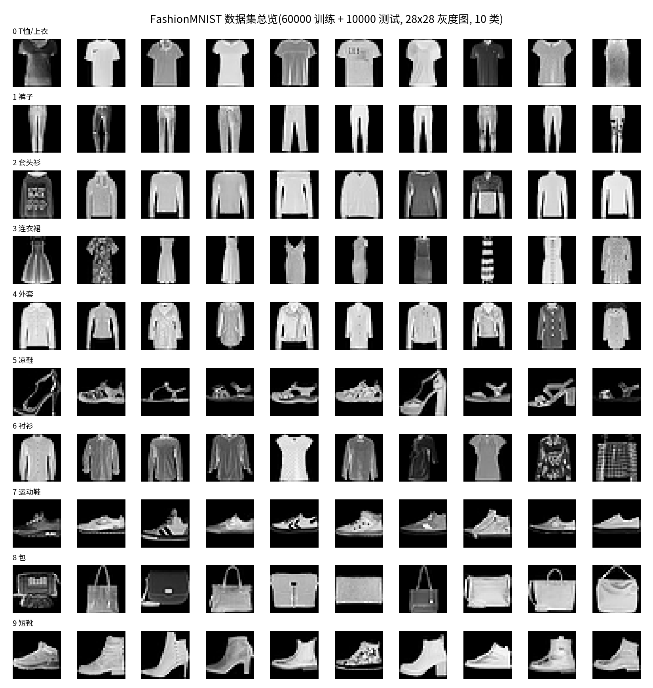

同一类别内部外观差异大(如"T恤"与"衬衫"、"外套"与"套头衫"),跨类别外观接近,是本数据集的主要分类难点,后文各模型的混淆矩阵均体现了这一点。

---

## 3 实验一:K-Means 聚类(内容 2)

### 3.1 方法

- 将 60000 张训练图展平为 784 维向量,像素值缩放至 [0,1];
- `sklearn.cluster.KMeans(n_clusters=10, n_init=10, random_state=42)`,初始化采用 k-means++;
- 聚类是无监督的,簇编号与真实类别没有天然对应,因此用**匈牙利算法**(`scipy.optimize.linear_sum_assignment`)求簇→类别的最优一一映射后统计准确率;同时报告 **NMI(归一化互信息)** 与 **ARI(调整兰德指数)** 两个无需外部匹配的无监督指标;
- 用 PCA 降到 2 维做可视化,并绘制聚类中心、簇-类别混淆矩阵、每簇样本示例。

### 3.2 结果

| 指标 | 数值 |
|---|---|
| 聚类准确率(匈牙利匹配) | **47.38%** |
| NMI | 0.5118 |
| ARI | 0.3479 |
| K-Means 目标函数 inertia | 1.91×10⁶ |
| 耗时 | 62.1 s(CPU) |

**簇 → 类别匹配结果**(按匈牙利算法最优分配):

| 簇 | 0 | 1 | 2 | 3 | 4 | 5 | 6 | 7 | 8 | 9 |
|---|---|---|---|---|---|---|---|---|---|---|
| 类别 | 运动鞋 | 外套 | 包 | 衬衫 | 裤子 | 短靴 | T恤/上衣 | 连衣裙 | 凉鞋 | 套头衫 |
| 样本数 | 6570 | 9619 | 2569 | 7466 | 9078 | 4295 | 7391 | 2903 | 7763 | 2346 |

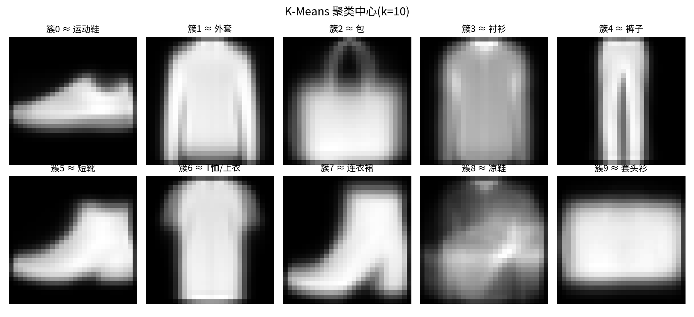

**观察与分析**:

1. 鞋类(运动鞋/凉鞋/短靴)与包、裤子等**轮廓突出**的类别各自聚成较纯的簇,聚类中心也呈现清晰的对应形状;
2. 上装类(T恤、衬衫、外套、套头衫、连衣裙)互相严重混淆——它们在 784 维原始像素空间中形状高度相似,而 K-Means 以欧氏距离按"像素重叠度"聚类,无法捕捉袖型、领口等语义差异,这是 47.38% 准确率的主要瓶颈(见簇-类别混淆矩阵);
3. PCA 二维散点(两主元方差解释率仅 29.1%+17.8%)同样显示:上装类在低维空间中彼此重叠,而鞋类/包/裤子形成可分的团块;
4. **注意"全局最优匹配 ≠ 簇内多数类"**:匈牙利算法求的是总分最大的全局分配,个别簇的分配结果可能与簇内多数样本不符(如"每簇样本示例"图中,簇 7 被分配给连衣裙,但其显示的样本以短靴居多——短靴名额已由总体收益更大的簇 5 占据),这正是无监督聚类类间混叠的直观体现;
5. 结论:纯无监督的原始像素 K-Means 只能达到约 47%,远低于监督方法;若先做特征提取(如用 CNN 中间层表征)再聚类,可大幅提升。

| 簇-类别混淆矩阵 | PCA 二维分布 | 每簇样本示例 |
|---|---|---|
| 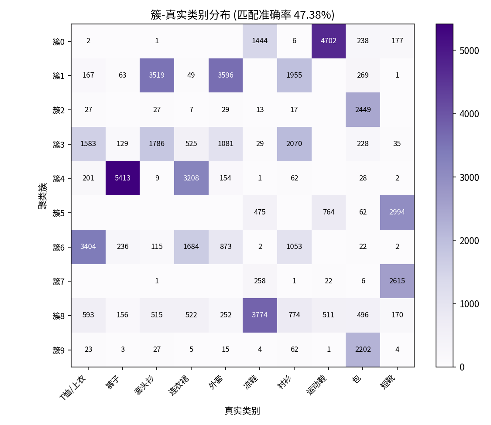 | 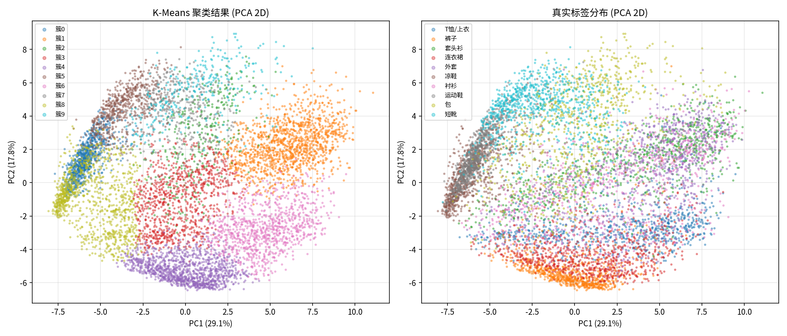 | 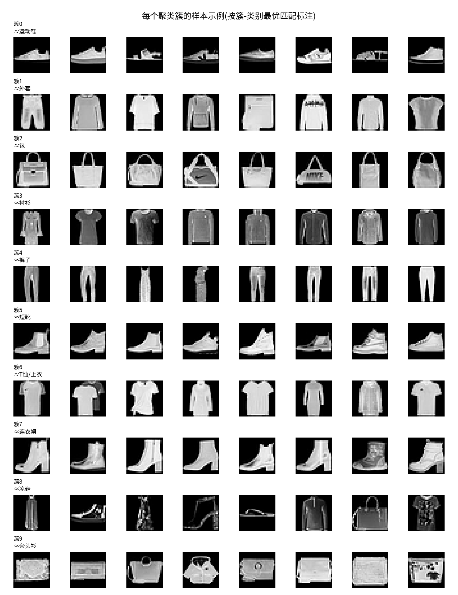 |

---

## 4 实验二:浅层 CNN 分类(内容 3)

### 4.1 网络结构(自建浅层 CNN,共 421,834 参数)

| 层 | 结构 | 输出尺寸 |
|---|---|---|
| 输入 | 28×28×1 灰度图 | 1×28×28 |
| 卷积块1 | Conv2d(1→32, 3×3, padding=1) + BatchNorm + ReLU + MaxPool(2×2) | 32×14×14 |
| 卷积块2 | Conv2d(32→64, 3×3, padding=1) + BatchNorm + ReLU + MaxPool(2×2) | 64×7×7 |
| 全连接1 | Flatten(3136) → Linear(3136→128) + ReLU + Dropout(0.5) | 128 |
| 全连接2 | Linear(128→10) | 10 |

### 4.2 训练配置

Adam(lr=1e-3)+ 余弦退火学习率,CrossEntropyLoss,batch=128,固定 5 个 epoch(训练共 13.7 s,GPU 推理约 1 s/万张)。

### 4.3 结果

- **最终测试集准确率 91.05%**,macro-F1 0.9099;
- 第 1 个 epoch 后测试准确率即达 88.06%,收敛快,5 epoch 内无过拟合迹象(测试损失单调下降 0.327→0.241)。

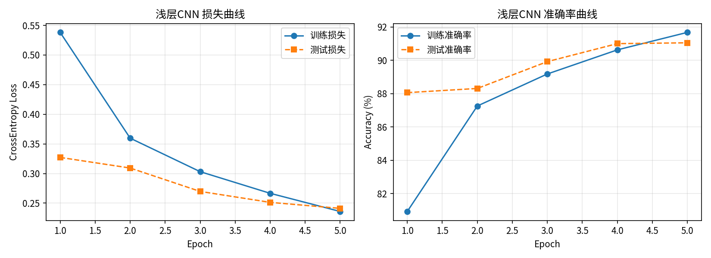

**逐类别表现**(recall):裤子 97.7%、包 98.6%、运动鞋 96.6%、短靴 97.2% 都很好;最差的是**衬衫,仅 69.2%**,其次 T恤 88.0%、外套 84.6%、套头衫 88.2%——混淆矩阵显示衬衫被大量误判为 T恤/外套/套头衫,印证了 3.2 节中"上装相似"的难点,但监督学习 CNN 通过学习特征把这一难点下的整体准确率从 47.38%(无监督)提升到了 **91.05%**。

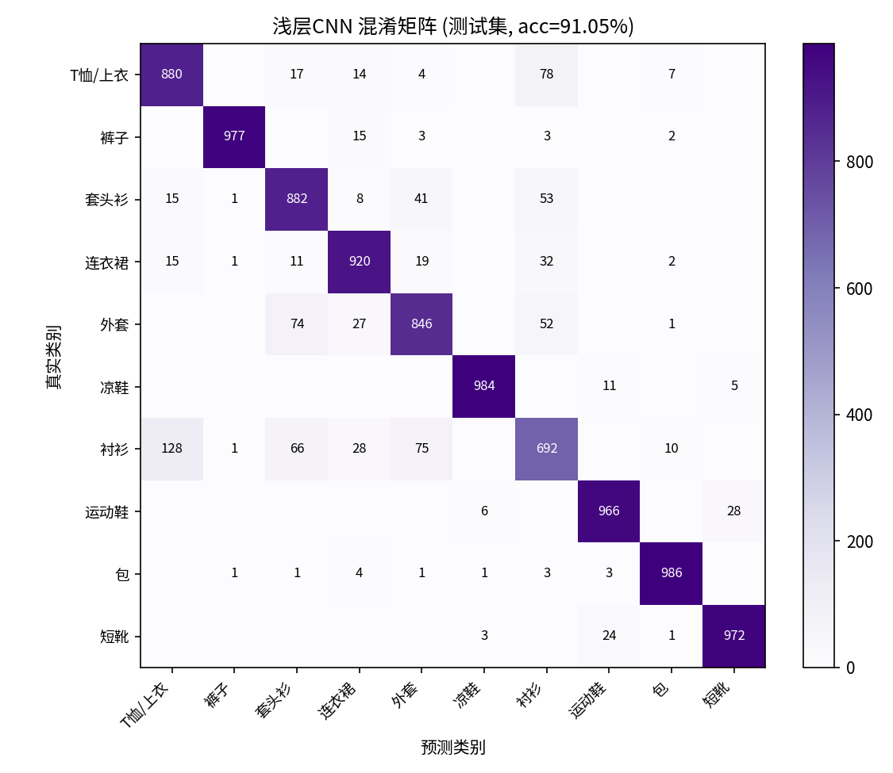

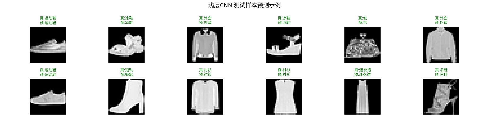

---

## 5 实验三:RNN/GRU 时序神经网络分类(内容 4)

### 5.1 图像序列化与模型

把 28×28 图像自上而下逐行扫描为 **28 个时间步、每步 28 维**的序列(模拟逐行阅读图像),取最后时间步隐状态接全连接输出十分类。为对比门控机制的作用,训练了两个模型:

| 模型 | 结构 | 参数量 |
|---|---|---|
| vanilla RNN | 2 层 RNN,hidden=128,层间 Dropout 0.3 | 54,538 |
| GRU | 2 层 GRU,hidden=128,层间 Dropout 0.3 | 161,034 |

两者均:Adam(lr=1e-3)+ 余弦退火,batch=128,5 epochs。

### 5.2 结果

| 模型 | 最终测试准确率 | macro-F1 | 训练耗时 |
|---|---|---|---|
| RNN | **82.16%** | 0.8203 | 23.3 s |
| GRU | **88.42%** | 0.8834 | 10.3 s |

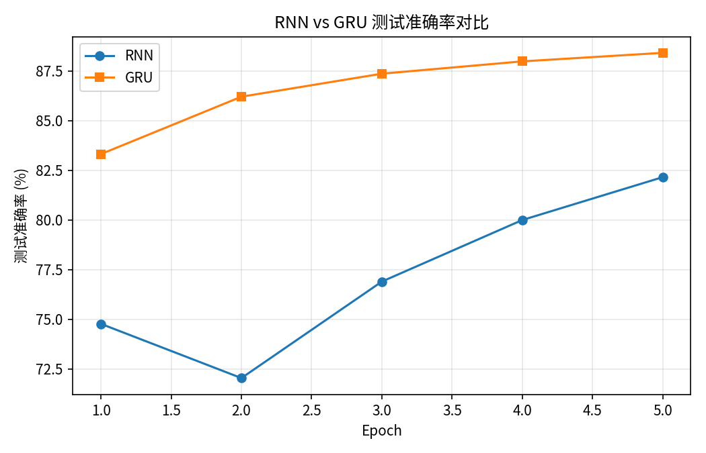

**观察与分析**:

1. GRU 显著优于 vanilla RNN(+6.26 个百分点):RNN 的隐状态每步都被覆写,逐行扫描时行与行之间的长程依赖在 28 步后基本丢失,梯度也易衰减/爆炸(训练曲线在 epoch 2 出现波动);GRU 的更新门/重置门可选择性地保留历史信息,故收敛更稳、精度更高;
2. 两模型最差类别仍是**衬衫**(GRU recall 64.0%,RNN 仅 48.1%),难点与 CNN 一致;
3. 时序模型把图像"降维"为 28 步序列,参数量小(5~16 万)、推理快(0.33 s/万张),但精度上限低于 CNN——全局空间结构(如"袖子在身体两侧")对逐行扫描的网络并不友好;
4. GRU 88.42% 已超过全连接 MLP 的典型水平(约 89% 附近),说明门控循环网络能在一定程度上建模图像的空间相关性。

| RNN 曲线 | GRU 曲线 |
|---|---|
| 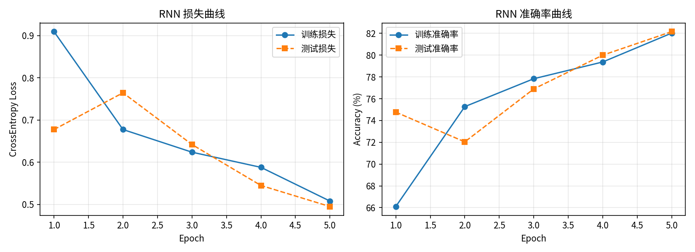 | 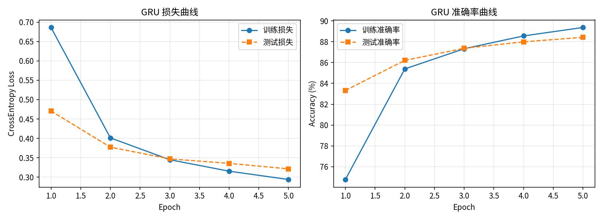 |

| RNN 混淆矩阵 | GRU 混淆矩阵 |
|---|---|
| 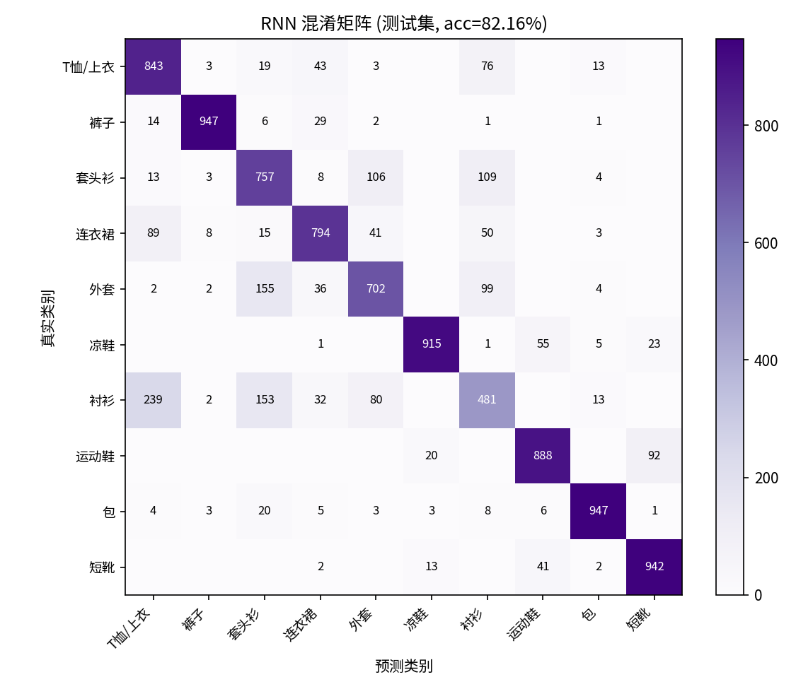 | 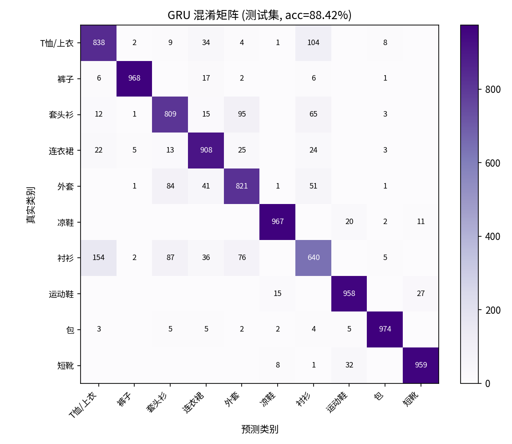 |

| RNN 预测示例 | GRU 预测示例 |
|---|---|
| 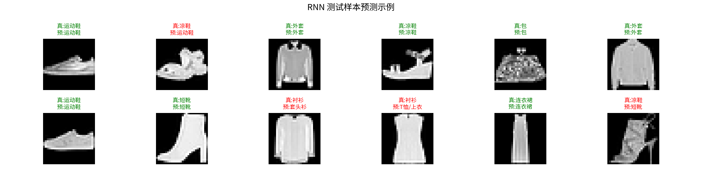 | 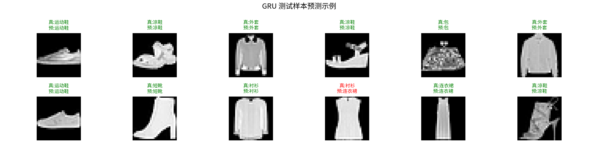 |

---

## 6 三种方法对比与总结

| 方法 | 学习范式 | 参数量 | 测试准确率 | 特点 |
|---|---|---|---|---|
| K-Means(k=10) | 无监督聚类 | — | 47.38%(匈牙利匹配) | 不用标签;只能分离轮廓差异大的大类(鞋/包/裤),上装类混叠 |
| 浅层 CNN | 有监督分类 | 421,834 | **91.05%** | 卷积权值共享保留二维局部结构,精度最高,训练仅约 14 s |
| RNN(2 层) | 有监督分类 | 54,538 | 82.16% | 参数最少;长程依赖丢失导致曲线波动、精度受限 |
| GRU(2 层) | 有监督分类 | 161,034 | **88.42%** | 门控机制有效;优于 MLP 典型水平,仍受逐行扫描的建模限制 |

**结论**:

1. **监督 >> 无监督**:同样面对 FashionMNIST,利用标签的 CNN 比 K-Means 聚类高 43.7 个百分点;
2. **归纳偏置决定效果**:CNN 的局部连接+权值共享最贴合图像的二维空间结构,故最好;GRU 把图像当序列,精度次之但参数更少;K-Means 无任何特征学习,只能完成"粗分";
3. **门控机制重要性**:GRU 比 vanilla RNN 高 6.26 个百分点,验证了门控对长序列依赖建模的必要性;
4. **共同难点**:所有模型在"衬衫"及上装类之间都最易混淆,这是数据本身类间相似性决定的。

**改进方向**:

- K-Means:先用预训练 CNN 提取特征再聚类,或用 GMM/谱聚类;
- CNN:加深网络(VGG/ResNet 风格残差块)、数据增强(随机翻转/裁剪),FashionMNIST 上可到 93~95%;
- RNN/GRU:采用双向扫描、注意力机制,或增加 hidden 维度/层数;
- 训练更久(如 20 epoch + 早停)通常还能再涨 1~2 个百分点。

---

## 附录:代码与复现

```
人工智能实验/
├── data/FashionMNIST/          # 数据集(自动下载)
├── src/
│   ├── common.py               # 公共模块:数据加载/训练评估工具/绘图(含中文字体处理)
│   ├── exp1_kmeans.py          # 实验一:K-Means 聚类
│   ├── exp2_cnn.py             # 实验二:浅层 CNN
│   └── exp3_rnn.py             # 实验三:RNN/GRU
├── results/
│   ├── exp1_kmeans_metrics.json / exp2_cnn_metrics.json / exp3_rnn_metrics.json
│   ├── shallow_cnn_best.pt / rnn_best.pt / gru_best.pt      # 模型权重
│   └── *.png                   # 全部图表
└── 实验报告.md
```

复现命令(任意目录均可,脚本按相对位置定位数据与结果目录):

```bash
python3 src/exp1_kmeans.py   # K-Means 聚类,约 1 分钟
python3 src/exp2_cnn.py      # 浅层 CNN,5 epoch,GPU 约 30 秒
python3 src/exp3_rnn.py      # RNN + GRU 各 5 epoch,GPU 约 40 秒
```

随机种子固定为 42;GPU 训练存在 cuDNN 非确定性,重跑指标可能有 ±0.1% 以内波动。本报告数据取自最近一次完整运行的 JSON 输出。
